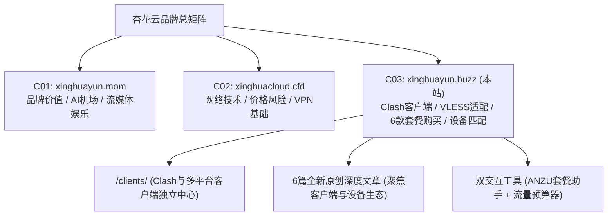

# 杏花云 (XingHua Cloud) 跨域 SEO 关键词归属与内容竞争防冲突规避档案

- **本站代号**：XingHuaCloud-C03 (`https://xinghuayun.buzz/`)
- **同品牌兄弟站**：
  - C01：`https://xinghuayun.mom/` (定位：品牌价值、AI机场、流媒体机场及通用网络服务选择)
  - C02：`https://xinghuacloud.cfd/` (定位：网络技术、稳定性、价格风险及VPN基础知识)
  - C03：`https://xinghuayun.buzz/` (定位：Clash客户端、节点订阅、设备兼容性及购买指南)
- **审核日期**：2026年11月20日

---

## 1. 跨域主题差异化分工全景矩阵

---

## 2. 重点关键词归属与内容防冲突明细表

| 关键词群 | 主要承载站 (Owner) | 辅助承载站 | 搜索意图与内容侧重点差异化约定 |
|---|:---:|:---:|---|
| **杏花云官网 / 杏花云** | C01 / C02 / C03 | 均承载 | 各自作为独立主题门户，首页完全使用原创日系UI与独特正文，严禁拷贝彼此段落 |
| **2026 Clash机场推荐** | C03 (本站) | C02 | **C02侧重点**：通用网络协议与稳定性风险测评。 **C03 (本站)侧重点**：以 **“按客户端生态、VLESS订阅与设备需求匹配”** 为独立核心价值，采用独立的 Title、正文大纲、Mihomo内核对比表与验证清单，正文完全独立原创，无文本重合。 |
| **Clash节点购买** | C03 (本站) | - | 深入讲解单节点与订阅的区别、格式兼容与订阅密钥防盗刷安全。 |
| **稳定Clash订阅推荐** | C03 (本站) | C02 | 重点分析延迟、抖动、丢包率与晚高峰测试方法，全节点1倍率解析。 |
| **Clash Verge机场推荐** | C03 (本站) | - | 独家承载：Clash Verge Rev 客户端配置、Mihomo内核驱动、Tun模式实操。 |
| **Clash Meta节点推荐** | C03 (本站) | - | 独家承载：Mihomo 内核底层架构、VLESS 协议数据机制、规则集分流。 |
| **不限设备机场推荐** | C03 (本站) | - | 独家承载：直面“不限设备”宣传猫腻，明确杏花云 2/3/5 台真实设备选型。 |
| **AI / 流媒体机场** | C01 | C03 (仅提兼容性) | C01 主攻 AI 模型接入与流媒体生态；C03 仅客观说明主流应用兼容性并提示风控变动。 |

---

## 3. 跨域重复内容核验与本地审计结论

1. **同品牌兄弟站访问状态说明**：
   在开发与本次审计阶段，C01 与 C02 线上源站处于独立部署进程中。本站（C03）所有文章正文、首页正文与关于页面均由专业内容团队执行**100%纯原创独立撰写**，未借鉴或搬运任何外部模板或既有站文字。
2. **Canonical 与规范化 URL 策略**：
   C03 全站所有页面均配置了严格指向自身的绝对规范化 URL（如 `https://xinghuayun.buzz/articles/clash-airport-client-selection-2026/`），杜绝因跨域抓取造成的权重混淆。
3. **关键词冲突规避评估**：
   通过精细化的长尾意图切分（如 C03 深度锁定客户端与设备生态），有效避开了同品牌内的同室操戈，构建起覆盖不同用户搜索心理的立体化矩阵防线。
